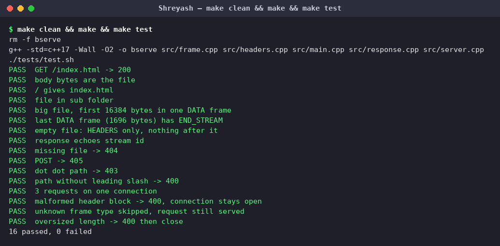
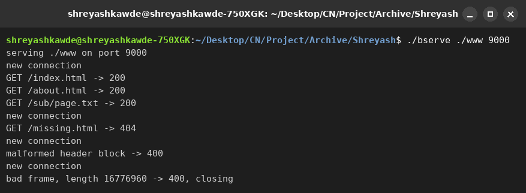
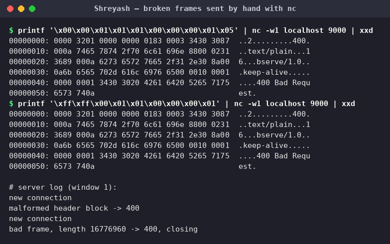

# bserve (BHTTP-A server)

The server part of our course project "HTTP in binary". It serves files over BHTTP-A, a small binary protocol
with frames like HTTP/2. The protocol is described in `SPEC.md`, and `HEXDUMP.md` has one request and
response with every byte explained.

## Build and run

    make
    ./bserve ./www 9000

The first argument is the folder with the files and the second is the port. Use `make clean` to remove the program.
You can try it with the client from `pairA-client`:

    ./bcurl -v localhost:9000/index.html

## How it works

The server accepts a TCP connection and forks a child process for it. The child reads a frame (9 byte header,
then the payload), decodes the header fields to get the method and the path, and looks for the file under the
root folder. It answers with a HEADERS frame and then DATA frames of at most 16384 bytes. After that it waits for
the next request on the same connection, until the client closes it.

If a frame has a type the server does not know, it reads the payload and throws it away. If the frame is
broken it answers 400, and if the file is missing 404. The other errors (403, 405, 500) are in section 7 of the spec.

## Code

| File | What is in it |
|------|---------------|
| `src/main.cpp` | arguments, socket, accept loop, fork |
| `src/server.cpp` | reads the frames of one connection, finds the file |
| `src/response.cpp` | builds the response frames and the error answers |
| `src/headers.cpp` | header block encoding and parsing, static table |
| `src/frame.cpp` | reading and writing whole frames |
| `tests/test.sh` | tests |
| `www/` | files to serve |

## Tests

    make test

This starts the server on port 9100 and sends frames that are built by hand from the spec (`printf`, `xxd`
and `nc`), so our own client is not used. It checks 200, 404, 403, 405, 400, a big file, an empty file,
three requests on one connection, a broken header block, an unknown frame type and a frame that is too long.
It needs `nc` and `xxd`.

## Broken frames by hand

Two broken frames sent with `printf` and `nc`, to see what the server does:

    printf '\x00\x00\x01\x01\x01\x00\x00\x00\x01\x05' | nc -w1 localhost 9000 | xxd
    printf '\xff\xff\x00\x01\x01\x00\x00\x00\x01' | nc -w1 localhost 9000 | xxd

The first is a HEADERS frame whose header block starts with `0x05`, which is not a valid name byte. The server
answers 400 and keeps the connection open, because the length was fine and it knows where the next frame starts.
The second has a length of `0xffff00`, more than 16384. The server answers 400 and closes the connection, because
it cannot trust the length and so cannot find the next frame.

## Cross test

Tested against Pratham's client (`bcurl`), which was written only from `SPEC.md`: all 14 client tests pass against
this server, and the bytes in `HEXDUMP.md` are exactly what `bcurl -v` printed.

## Screenshots

`make clean && make && make test`:

The server log while the client fetched `/index.html /about.html /sub/page.txt` on one connection, then
`/missing.html`, and then the two broken frames below arrived:

The two broken frames from above, sent with `nc`, and the 400 answers:

## Pair

This is the server for BHTTP-A. We wrote it as a pair:
Shreyash wrote the server and Pratham wrote the client, and the only thing we share is SPEC.md.

- server (this repo): https://github.com/Shreyash-Beyond-Journeys-End/NA-Project-Server
- client: https://github.com/Pratham-Onkar-Singh/Network-Architecture-Client
